# ⚡ Awesome API Development & Testing Tools 🛠️

**Curated ecosystem of SaaS platforms, open-source testing suites, local clients, contract validators, and load generators.**

  <a href="#-sector-overview--market-dynamics">Sector Overview</a> •
  <a href="#-saashosted-platforms">SaaS Platforms</a> •
  <a href="#-open-source-github-projects">Open-Source Repositories</a> •
  <a href="#-recommended-toolchain-stacks">Toolchain Stacks</a> •
  <a href="#-how-to-contribute">Contribute</a> •
  <a href="#-support">Support</a> •
  <a href="#-star-history">Star History</a>

---

## 🌐 Sector Overview & Market Dynamics

The global API testing and management ecosystem is valued at over **$10 billion** as of 2024–2026 (with dedicated API Testing projected to grow at an **18%–23% CAGR** toward $7B–$11B+ by 2030, and broader API Management exceeding $20B). The market is **moderately fragmented**: while a handful of dominant category leaders (such as Postman and Kong) capture massive global developer mindshare, the space resists a winner-take-all monopoly due to aggressive enterprise unbundling, regulatory compliance shifts, and rapid community-wide adoption of local-first, privacy-focused open-source alternatives.

---

## 📑 Table of Contents

- [🌐 Sector Overview & Market Dynamics](#-sector-overview--market-dynamics)
- [☁️ SaaS/Hosted Platforms](#-saashosted-platforms)
- [💻 Open-Source GitHub Projects](#-open-source-github-projects)
- [🏗️ Recommended Toolchain Stacks](#-recommended-toolchain-stacks)
- [🤝 How to Contribute](#-how-to-contribute)
- [❤️ Support](#️-support)
- [⚖️ Disclaimer](#️-disclaimer)
- [⭐ Star History](#-star-history)

---

## ☁️ SaaS/Hosted Platforms

The table below catalogs major hosted SaaS platforms for API development, testing, collaboration, and governance. Platforms are ordered in descending order based on estimated company size (market valuation or annual revenue run-rate).

| Platform 🚀 | Company Size / Valuation 📊 | Starting Tier Pricing 💳 | Free Tier / Trial Limits 🎁 | Core Specialization 🎯 |
| :--- | :--- | :--- | :--- | :--- |
| **[Postman](https://postman.com)** | **$5.6 Billion Valuation** (Est. ~$300M ARR) | **$19** / user / month (Basic billed annually) or $24 billed monthly | **Free Forever**: Single user only (0 shared team members); includes up to 10,000 Postman API calls/month, 5 integrations, and 50 AI credits/month. | Comprehensive collaborative API lifecycle, request builder, testing, and mock server cloud platform. |
| **[RapidAPI](https://rapidapi.com)** | **$1.0 Billion Valuation** ($150M Series D) | **$10** / month (Developer base subscription) | **Free Forever**: Discover public APIs, execute up to basic plan threshold endpoints; Paw desktop client offers a 14-day fully featured free trial. | Global API marketplace, hub discovery, endpoint testing, and macOS Paw HTTP client suite. |
| **[SwaggerHub](https://swagger.io)** | **$250 Million Revenue** (SmartBear parent ARR) | **$19** / user / month (Individual billed annually) or $25 monthly | **Free Forever**: 1 user only; access to OpenAPI editor and basic hosted docs portal capped at ~1,000 requests/month rate limit. | Enterprise OpenAPI and AsyncAPI specification modeling, schema governance, and team documentation portal. |
| **[Stoplight](https://stoplight.io)** | **$250 Million Revenue** (Acquired by SmartBear) | **$39** / user / month (Starter plan billed annually) | **14-day Free Trial** (Full access to visual OpenAPI designer, style guide governance, and Prism mock engine). | Design-first API architecture platform featuring visual contract linting and collaborative mock portals. |
| **[Insomnia Hosted](https://insomnia.rest)** | **$100M+ Kong ARR** (Acquired by Kong Inc.) | **$12** / user / month (Pro plan billed annually) or $15 monthly | **Free Forever**: Free local-first use and Git sync for small teams up to 3 users; mock server testing capped at 1,000 requests/month. | Cloud-synchronized, end-to-end encrypted API client for REST, GraphQL, gRPC, and WebSockets. |
| **[Apidog](https://apidog.com)** | **~$15 Million Valuation** (Bootstrapped / Early Growth) | **$9** / user / month (Basic plan billed annually) or $12 monthly | **Free Forever**: Up to 4 team members with unlimited projects, visual OpenAPI designer, automated test scenarios, and smart mocking. | All-in-one integrated workspace bridging API documentation, debugging, testing scenarios, and automated mocking. |
| **[Thunder Client](https://thunderclient.com)** | **~$3 Million Valuation** (Independent Developer Tooling) | **$3** / user / month (Starter plan billed annually) or $4 monthly | **Free Forever**: Unlimited local REST API requests inside VS Code; team sync & Git integration capped at 1 local workspace without team sync. | Lightweight, GUI-based REST client extension operating natively inside Visual Studio Code. |

---

## 💻 Open-Source GitHub Projects

The following active open-source repositories power local-first API development, automated regression testing, contract verification, load benchmarking, and mocking. Repositories are decorated with live stargazers count badges and sorted in **descending order by Stars_Count**.

| Repository & GitHub_Stars ⭐ | Description 📝 | Primary Focus 🔍 |
| :--- | :--- | :--- |
| **[hoppscotch/hoppscotch](https://github.com/hoppscotch/hoppscotch)**    | Open-source API development ecosystem. Self-hostable web, desktop, and CLI client supporting REST, GraphQL, WebSocket, SSE, Socket.IO, and MQTT. | Web & Desktop API Client |
| **[usebruno/bruno](https://github.com/usebruno/bruno)**    | Fast, Git-friendly open-source API client storing collections as plain-text `.bru` files directly inside your code repository for version-controlled testing. | Local-First Git API Client |
| **[Kong/insomnia](https://github.com/Kong/insomnia)**    | Cross-platform desktop API client for GraphQL, REST, WebSockets, SSE, and gRPC with local-first, Git, and end-to-end encrypted synchronization. | Multi-protocol API Client |
| **[httpie/cli](https://github.com/httpie/cli)**    | Modern, user-friendly command-line HTTP client with intuitive syntax, colored JSON output, persistent sessions, and plugins. | Terminal HTTP CLI |
| **[grafana/k6](https://github.com/grafana/k6)**    | Modern developer-centric load and performance testing tool using Go and JavaScript/TypeScript for CI/CD endpoint benchmarking. | Load & Performance Testing |
| **[locustio/locust](https://github.com/locustio/locust)**    | Scalable, distributed load testing framework defining user test behaviors in pure Python code with real-time web dashboard monitoring. | Distributed Load Testing |
| **[keploy/keploy](https://github.com/keploy/keploy)**    | Zero-code API testing platform utilizing eBPF to capture production network traffic and DB calls, converting them into automated deterministic test suites and mocks. | eBPF Traffic Replay & Mocks |
| **[mountain-loop/yaak](https://github.com/mountain-loop/yaak)**    | Extremely fast, native desktop REST, GraphQL, WebSockets, Server-Sent Events, and gRPC client built in Rust and Tauri. | Lightweight Native Desktop Client |
| **[Orange-OpenSource/hurl](https://github.com/Orange-OpenSource/hurl)**    | High-performance Rust CLI tool that runs HTTP requests defined in plain text, asserting headers, status codes, and JSON/HTML bodies across chained requests. | Plain-Text HTTP Test Runner |
| **[darrenburns/posting](https://github.com/darrenburns/posting)**    | Keyboard-centric Terminal User Interface (TUI) API client that lives directly in your shell, featuring jump keys, syntax highlighting, and environment configs. | Terminal TUI API Client |
| **[artilleryio/artillery](https://github.com/artilleryio/artillery)**    | Cloud-scale serverless load testing and API stress framework supporting HTTP, GraphQL, WebSockets, and Playwright integration. | Serverless Load Testing |
| **[karatelabs/karate](https://github.com/karatelabs/karate)**    | Unified test automation framework combining API testing, mocks, performance testing, and UI automation in a clean BDD domain language. | BDD Framework & Mocks |
| **[mockoon/mockoon](https://github.com/mockoon/mockoon)**    | Easiest and fastest local mock server app. Run mock APIs with rules, delays, proxying, and Docker container support without cloud dependencies. | Local API Mocking Server |
| **[wiremock/wiremock](https://github.com/wiremock/wiremock)**    | Robust HTTP service virtualization tool for stubbing and mocking microservices, simulating network latency, and injecting faults. | Service Virtualization |
| **[rest-assured/rest-assured](https://github.com/rest-assured/rest-assured)**    | Celebrated Java DSL for simplifying functional testing and JSON/XML schema validation of REST services in enterprise test pipelines. | Java API Testing DSL |
| **[gatling/gatling](https://github.com/gatling/gatling)**    | Highly optimized asynchronous load-testing tool supporting Java, Kotlin, Scala, and TypeScript for high-concurrency API benchmarking. | High-Concurrency Load Testing |
| **[stoplightio/prism](https://github.com/stoplightio/prism)**    | HTTP mock server that turns OpenAPI 2/3 definitions into live mock servers with request validation and response contract verification. | OpenAPI Mocking & Validation |
| **[schemathesis/schemathesis](https://github.com/schemathesis/schemathesis)**    | State-of-the-art property-based testing and fuzzing engine that generates thousands of boundary tests directly from OpenAPI/GraphQL schemas. | Property-Based API Fuzzing |
| **[microcks/microcks](https://github.com/microcks/microcks)**    | CNCF incubating Kubernetes-native API mocking and contract testing tool covering OpenAPI, AsyncAPI, gRPC, and GraphQL specifications. | Cloud-Native Contract Mocking |
| **[stepci/stepci](https://github.com/stepci/stepci)**    | Declarative YAML-based API testing and QA automation framework for functional assertions, load generation, and security checks in CI/CD. | Declarative CI/CD Testing |
| **[pact-foundation/pact-js](https://github.com/pact-foundation/pact-js)**    | Contract testing implementation enabling consumer-driven contracts for microservices across HTTP and event streams. | Consumer-Driven Contracts |
| **[taverntesting/tavern](https://github.com/taverntesting/tavern)**    | Command-line tool and pytest plugin for automated testing of RESTful and MQTT APIs using concise and human-readable YAML specs. | Pytest YAML Integration |
| **[specmatic/specmatic](https://github.com/specmatic/specmatic)**    | Shift-left contract-driven development tool converting OpenAPI specs into executable contract tests and auto-generated mocks. | Executable Contract Specs |
| **[4yk5/Ghostman](https://github.com/4yk5/Ghostman)**    | Distraction-free, fast keyboard-driven TUI API client and webhook inspector engineered for zero cloud dependencies and immediate execution. | Lightweight TUI Client |

---

## 🏗️ Recommended Toolchain Stacks

Need to construct an end-to-end API testing and validation suite? Here are battle-tested combinations:

- **Interactive Local Development**: `usebruno/bruno` or `mountain-loop/yaak` (replaces bloated desktop suites with clean local files).
- **Automated CI/CD Regression & Fuzzing**: `Orange-OpenSource/hurl` + `schemathesis/schemathesis` (plain-text assertions combined with property-based boundary fuzzing).
- **Service Virtualization & Mocking**: `mockoon/mockoon` or `stoplightio/prism` (instant local mocks straight from OpenAPI files).
- **Stress & Concurrency Benchmarking**: `grafana/k6` or `locustio/locust` (code-driven load testing integrated into deployment gates).
- **Microservice Contract Integrity**: `pact-foundation/pact-js` or `specmatic/specmatic` (prevent breaking changes across distributed dependencies).

---

## 🤝 How to Contribute

Contributions make the open-source community thrive! Follow these steps to submit additions:

1. 🍴 **Fork the Repository**: Clone your fork locally.
2. 🌿 **Create a Branch**: `git checkout -b feature/add-new-tool`
3. ✏️ **Edit `README.md`**:
   - For SaaS tools: Add accurate pricing tiers, verified free limits, and estimated company valuation/revenue in the table.
   - For Open-Source projects: Insert repo link, live Stars_Badge, description, and place it in the correct descending Stars_Count position.
4. 🚀 **Submit a Pull Request**: Provide a concise summary and official source links for verification.

---

## ❤️ Support

Thank you so much for exploring and using this repository! If this curated guide helps simplify your API architecture, please consider:
- ⭐ **Starring this repository** to help other developers discover it
- 🍴 **Forking and sharing** with your engineering team and DevOps colleagues
- ☕ **Sponsoring the maintainer** via the [GitHub Sponsor Dashboard](https://github.com/sponsors/ishandutta2007)

Your support keeps this registry updated, accurate, and community-driven! 🚀

---

## ⚖️ Disclaimer

- This is a community-curated collection for educational and technical evaluation purposes.
- Fuzzing and high-concurrency load testing tools (`schemathesis`, `k6`, `locust`) should **only** be executed against pre-production, staging, or authorized sandbox endpoints.
- Always prevent credentials, API tokens, and secret keys from entering version control by utilizing `.env` files or secret managers.

---

## ⭐ Star History

